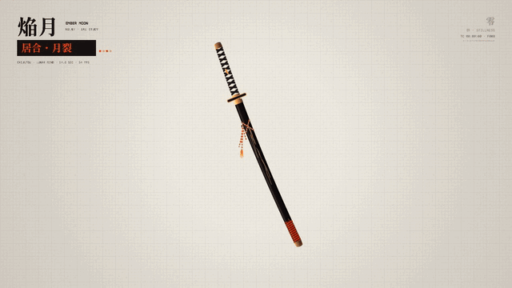

# 焔月 Ember Moon — Iai Study

A 14.6-second katana motion piece drawn live in the browser with Canvas 2D. One HTML file, no build step, no libraries.

**[▶ Watch it live](https://matthew-eucaristo.github.io/ember-moon/)**

## Chapters

| | Chapter | What happens |
|---|---|---|
| 零 | Stillness | A sheathed katana floats on grid paper. The sageo cord sways with gravity. |
| 壱 | The Draw | The blade leaves the saya in a white flash. A brush ring paints itself on and the world goes dark. |
| 弐 | One Flash | A crescent slash splits the ring and leaves a single glowing line. |
| 参 | The Rift | The line tears open into a crackling rift. Shards fly, lightning arcs, and a slit-pupil eye looks around. |
| 肆 | Maelstrom | The pupil becomes a vortex. Three cross slashes land and the screen whites out. |
| 伍 | Sheathe | A halftone ink wipe returns to paper. Blade and saya drift apart, then click home. |
| 陸 | Zanshin | A close pan along the sword, back to rest, and a 残心 seal stamps in. |

## Controls

| Key | Action |
|---|---|
| `Space` | Play / pause |
| `R` | Restart |
| `M` | Sound on / off (synthesized with WebAudio, off by default) |
| `←` `→` | Step one frame |

The transport bar has a scrubber with chapter ticks and ½× / ¼× speed.

## How it works

- Every element is a pure function of time `t`, so scrubbing and frame-stepping are exact.
- A seeded PRNG and value noise drive the jitter, so every play looks the same.
- Glow is layered strokes with additive blending. The rift edge "boils" at 12 fps by quantizing its noise.
- The ink wipe is a halftone dot field used as a clip mask.
- Sound effects are oscillators and filtered noise, triggered when playback crosses their timestamps.
- `prefers-reduced-motion` tones down shake and flashes and starts paused.

## Run locally

Open `index.html` in a browser.

## Credit

Inspired by [this katana VFX clip](https://x.com/Ssr360535694/status/2122934850407510386). The design, branding and code here are an original take.
